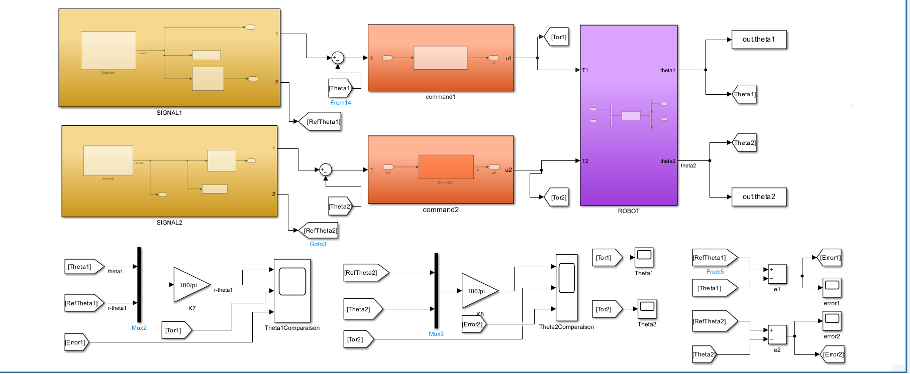

# 2-DOF Robotic Arm Nonlinear Control — 50× C-MEX, Fuzzy Logic, GA-PID & TI DSP TMS320C6713

[](https://scidelo-andriasahy.github.io/?project=4)
[](https://www.ti.com/product/TMS320C6713B)
[](#methodology)

> **Author:** Tsikomia Scidelo ANDRIASAHY — GSEA Engineering (ENSA Tangier)  
> **Live Project Showcase:** [https://scidelo-andriasahy.github.io/?project=4](https://scidelo-andriasahy.github.io/?project=4)



## Methodology & Highlights
- **Euler-Lagrange 2-DOF Dynamic Modeling:** Full coupled inertia matrix `M(q)`, Coriolis/centrifugal torques `C(q, dq)`, and gravity vector `G(q)`.
- **50× Simulink Acceleration via Compiled C-MEX S-Functions:** Rewrote plant dynamics and fuzzy inference in compiled ANSI C, enabling rapid Genetic Algorithm (GA-PID) optimization.
- **Comparative Control Benchmark:** Neural Networks (ANN) vs. Genetic Algorithm PID (GA-PID) vs. 49-rule Mamdani Fuzzy Logic Controller (FLC).
- **Real-Time Embedded Deployment:** Validated the robust Fuzzy Logic controller in C (`src/fuzzy_controller.c`, `src/robot_model.c`, `src/main.c`) and deployed it onto a floating-point **Texas Instruments DSP TMS320C6713**.

## Repository Structure
```text
├── src/           # Real C firmware (main.c, fuzzy_controller.c, robot_model.c), MATLAB analysis & CSV results
├── docs/          # Bilingual FR/EN DSP & 2-DOF Control Technical Reports (PDF)
└── media/         # Simulink diagrams, fuzzy rules, trajectory tracking plots & DSP hardware photos
```
